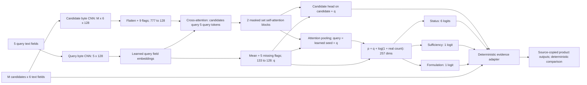

# Hybrid Set Transformer architecture and training evidence

Audit date: 23 November 2026. Specification verified against `notebooks/model_source.py`, Notebook 07, the full Colab run, saved tensor shapes/storage bytes, and the common evidence adapter. This document describes implementation and observed artifacts; the ACM manuscript is in Overleaf and was intentionally outside scope.

## Authoritative implementation and run

| Item | Exact location |
| --- | --- |
| Source | notebooks/model_source.py |
| Full run | ../hybrid_set_transformer_outputs/set_transformer_20261121T145558Z_63b2e44f |
| Run configuration | ../hybrid_set_transformer_outputs/set_transformer_20261121T145558Z_63b2e44f/configuration.json |
| Export | ../hybrid_set_transformer_outputs/set_transformer_20261121T145558Z_63b2e44f/inference_model_7db36ff4 |
| Full history | ../hybrid_set_transformer_outputs/set_transformer_20261121T145558Z_63b2e44f/history.json and history.csv |
| Selected / final training states | ../hybrid_set_transformer_outputs/set_transformer_20261121T145558Z_63b2e44f/best.pt and last.pt |
| Full development | ../hybrid_set_transformer_outputs/set_transformer_20261121T145558Z_63b2e44f/evaluations/development_7e46350d/ |
| Final outputs | ../hybrid_set_transformer_outputs/set_transformer_20261121T145558Z_63b2e44f/final_b5be6681/ |
| Local comparison copy | results/otc_models/set_transformer_final |
| Shared final adapter | results/otc_models/xgboost_20261121T102526Z_4b76aa52/prepared_data/otc_shared.py |

All exported files match `inference_model_7db36ff4/frozen.json`. Its model-source hash equals the repository implementation. All final output files match the comparison copies. The architecture has **881513 trainable parameters**. An independent count from the saved model tensor shapes agrees; `active_status` is a six-element Boolean buffer, excluded from the parameter count. Every exported tensor's shape, stride, offset, storage type and storage bytes match `best.pt`, including the buffer. No model forward pass or retraining was used.

PyTorch is not installed locally. Checkpoints were inspected through their ZIP containers using an allowlisted pickle metadata reader whose tensor rebuild function returns inert shape/storage descriptors; only expected OrderedDict/tensor/storage/NumPy-metadata symbols were accepted. This permits exact weight-byte and training-state verification without executing Torch or loading an optimizer. Original checkpoint files remain unchanged.

## Inputs

The unit processed by the network is **one product request with its entire variable-size source-candidate set**. A two-product comparison makes two network requests; comparison logic runs afterward. The dataset retains case IDs, targets and family metadata outside the predictor's input. `MedicineSets.__getitem__` returns the source item separately from its label. Payload checks reject reference/review/partition/label fields and prohibit candidate truncation.

Five query fields, in order:

1. Name.
2. Dosage form.
3. Route list joined with spaces.
4. Native strength strings joined with spaces.
5. Product NDC, when supplied.

Six text fields per candidate:

| Field | Actual concatenation |
| --- | --- |
| Names | Display name, brand name, generic name. |
| Ingredients | FDA structured active ingredient names plus paired RxNorm ingredient names. |
| Strengths | Native FDA ingredient strengths, preserving stated units/denominators. |
| Form/route | Dosage form plus joined route list. |
| Identifiers | Product NDC; SPL label ID, set ID, version and effective time; product RxCUI; product UNIIs; each paired ingredient RxCUI, term type and UNIIs. |
| Source text | Full SPL active-ingredient text, structured substance names, and RxNorm product name. |

The source fields include provenance identifiers, not only natural-language descriptions. Do not draw this as a model taking medicine names alone. No restricted RxNorm records need to appear in the scientific figure: show generic field names.

Nine candidate flags accompany these text fields, in order: missing FDA native ingredients; missing SPL active text; missing form; missing route; missing product RxCUI; exact original versions confirmed; raw NDC name matches catalog; raw form/route confirmed; cached RxNorm pairs confirmed. These are source-presence/provenance flags, not gold correctness flags. Five query-missing flags follow the same order as the query fields. A candidate cache is keyed by product NDC; cache state is cleared when runtime settings change.

## Byte CNN and field encoding

Text is NFKC-normalized, case-folded and whitespace-normalized, encoded as UTF-8 **bytes**, then shifted by one. The vocabulary has 257 entries: zero for padding and 1–256 for byte values. Empty normalized text uses a blank. Calling this a character CNN is conventional, but its actual tokens are bytes.

Long text is split into **160-byte chunks with six-byte overlap**, stride 154. The complete text is retained; neither candidates nor active text are truncated. Encoding uses two separate CNN modules: one shared across all query fields and one shared across all candidate fields. Their weights are not tied.

Each CNN contains:

- `Embedding(257, 32, padding_idx=0)`.
- Three parallel Conv1d branches, each 32 -> 48 channels, kernel widths 3, 5 and 7, same-length padding.
- GELU in each branch; padding-masked maximum over byte positions.
- Concatenation to 144 dimensions; Linear(144,128), GELU, LayerNorm(128).
- Elementwise maximum across a field's chunks, yielding one 128-vector per field.

Thus query field tokens have shape `B x 5 x 128`; candidate field encodings have shape `N_real_or_placeholder x 6 x 128`. Large CNN batches can use activation checkpointing in training; this changes memory use, not the model's architecture.

## Query and candidate representations

A learned `5 x 128` query-field embedding is added to the five field encodings. Their mean is concatenated with the five missing flags and projected by Linear(133,128), GELU and LayerNorm to query vector `q`.

Each candidate's six field vectors are flattened to 768 dimensions, concatenated with nine flags, and passed through Linear(777,128), GELU, LayerNorm and dropout 0.1. Batch candidate sets are padded to width M. There are **no candidate index or rank embeddings**.

Two Boolean masks have distinct roles: `valid` includes real candidates and an empty-set placeholder; `real` includes only actual source candidates. Empty sets receive one six-empty-field encoded placeholder with missing-source flags to avoid all-masked attention. Despite the source comment's “learned sentinel” wording, there is no separately parameterized sentinel embedding; the placeholder is encoded through the same learned CNN/projection. Its real candidate count is zero.

## Cross-attention, set attention and pooling

Every attention block uses hidden width 128, **4 heads** (32 dimensions per head), batch-first multi-head attention and dropout 0.1. Its update is:

`u = LayerNorm(Q + Dropout(MHA(Q,K,K)))`

`out = LayerNorm(u + Dropout(Linear(256,128)(Dropout(GELU(Linear(128,256)(u))))))`

The computational sequence is:

1. **Candidate-to-query cross-attention:** candidate embeddings are queries; the five query field tokens are keys/values. All five query tokens remain valid; missingness is represented explicitly rather than masking fields away.
2. **Two masked set self-attention blocks:** candidates serve as Q/K/V. Padded candidate keys are masked; padded outputs are zeroed after each block. This is full attention over the supplied set, without inducing-point layers.
3. **Query-conditioned attention pooling:** a learned `1 x 1 x 128` seed is expanded across B and added to q. This single query attends to the candidate set using the same mask/block structure, producing pooled vector p.
4. The scalar `log(1 + number_of_real_candidates)` is concatenated with p and q, producing the **257-dimensional request representation**.

Candidate permutation changes candidate-aligned outputs correspondingly, while pooled/request predictions are invariant in evaluation mode. The existing notebook contains synthetic invariance and empty-set software checks; these are not clinical or benchmark results.

## Four heads and deterministic output

| Head | Input | Layers | Meaning / activation |
| --- | --- | --- | --- |
| Candidate source support | Each final candidate vector + q: 256 dims | 256 -> 128 -> 1, GELU | Independent sigmoid per candidate; supervised for source support, not user-intent correctness. |
| Status | p + q + log-count: 257 dims | 257 -> 128 -> 6, GELU, dropout 0.1 | Softmax over exact NDC, formulation, ingredient set, insufficient information, no match, source conflict. |
| Evidence sufficiency | Same 257 dims | 257 -> 128 -> 1, GELU, dropout 0.1 | Sigmoid; target is whether source-policy status is supported. |
| Formulation assertion | Same 257 dims | 257 -> 128 -> 1, GELU, dropout 0.1 | Sigmoid; target is non-null complete formulation. |

The saved active-status mask is `[true,true,true,true,false,true]`; NO_MATCH logits are replaced by -10000 because that class has no training examples. The four heads do not generate ingredient names, strengths or comparison prose. A separate adapter copies candidate fields and computes comparisons. Do not add a learned comparison head or describe this as autoregressive medicine-answer generation.

## Parameter accounting

| Component | Parameters |
| --- | --- |
| query_character_cnn | 50224 |
| candidate_character_cnn | 50224 |
| query_field_embeddings | 640 |
| query_projection | 17408 |
| candidate_projection | 99840 |
| cross_attention_block | 132480 |
| two_self_attention_blocks | 264960 |
| query_conditioned_pool_block | 132480 |
| pool_seed | 128 |
| candidate_head | 33025 |
| status_head | 33798 |
| sufficiency_head | 33153 |
| form_head | 33153 |
| Total | 881513 |

There are four attention blocks in total: one cross-attention, two set self-attention and one pooling block, each 132480 parameters. The saved state dictionary has 97 tensor entries, including the non-trainable Boolean buffer.

## Scientific figure blueprint

Suggested caption: “Hybrid Set Transformer for source-grounded OTC identification. Separate byte CNNs encode request fields and complete candidate evidence. Candidate-to-query cross-attention, two masked set self-attention layers and query-conditioned pooling feed four supervised heads. A fixed adapter copies source-supported fields, enforces certainty constraints and computes ingredient comparisons. Hidden width 128, four attention heads, 881513 trainable parameters.” The caption's source-support wording refers to the evidence policy; it does not establish independent clinical correctness.

## Verified training configuration and selection

The full run uses all 75372 approved training cases / 94863 product requests, 9002 stopping cases / 10907 requests and 3352 calibration cases / 3942 requests. Split hashes match the prepared-data bundle; all split and quarantine checks pass. Model configuration, run configuration, export configuration and prediction freeze agree.

- Tesla T4; CUDA; FP16 mixed precision. The full run's saved configuration establishes this independently of the smoke notebook.
- Python 3.13.16; Torch 2.14.1+cu130; NumPy 2.4.6; pandas 2.2.3; Matplotlib 3.10.0; scikit-learn 1.6.1; jsonschema 4.26.0.
- Seed 42; nominal request batch size 32; padded-set slot budget 512. The slot budget is a packing target, not a cap on candidates: an oversized single request can exceed it, and no set is truncated.
- AdamW; learning rate 0.0003; weight decay 0.001; max 20 epochs; cosine scheduler with T_max 20; gradient clipping 1.0; patience 4; minimum validation improvement 0.0001.
- Multitask weights: candidate 1, sufficiency 1, status 1, formulation 0.5. Candidate BCE is masked and averaged per request before the batch average. Status loss uses class-balanced NLL; binary losses use positive weights capped at 10. Saved positive weights: candidate 1.0922676282051282, sufficiency 1.1251624176710426, formulation 10.0.
- Training status counts: 43089 exact NDC, 996 formulation, 553 ingredient set, 48796 insufficient information, 0 no match, 1429 source conflict. Candidate targets have 49920 positive / 54526 negative entries; formulation has 7883 positive / 86980 negative requests.

The run completed **six epochs**, selecting **epoch 2** with stopping total loss **0.7510674414633929**. `best.pt` stores zero-based epoch 1 and history through epoch 2; `last.pt` stores zero-based epoch 5, all six history rows, and four non-improving epochs. Its canonical configuration hash matches the saved configuration. Last checkpoint elapsed training equals the frozen **1201.3390398089996 seconds**. Summed per-epoch recorded durations are 1201.3390487699999 seconds; the 0.0000089610003-second difference follows separate timer calls and does not change either original value.

The numerical log has 15 events: 10 FP16 overflows/skipped steps and 5 scale increases. Last checkpoint records 18063 successful optimizer steps, 10 scale decreases, 5 increases and zero consecutive overflows. Selected epoch-2 checkpoint records 6016 optimizer steps and 6 skipped steps. Do not claim zero overflow; bounded handling is recorded in the source and artifacts.

## Complete observed training and stopping history

Every completed epoch is included below; all numbers are copied from `history.json`. `history.csv` agrees numerically, and checkpoint histories agree exactly. The stopping split is validation for early stopping; calibration does not produce a per-epoch training curve.

| Epoch | LR | Seconds | Train total loss | Stop total loss | Train status accuracy | Stop status accuracy | Skipped steps |
| --- | --- | --- | --- | --- | --- | --- | --- |
| 1 | 0.0003 | 208.2556239390001 | 0.8453318753677862 | 0.9309707848619705 | 0.9246597725140465 | 0.9470981938204822 | 6 |
| 2 | 0.00029815325108927063 | 200.54926961799993 | 0.5002693565112912 | 0.7510674414633929 | 0.9615761677366307 | 0.9543412487393417 | 0 |
| 3 | 0.00029265847744427303 | 199.83530191399996 | 0.3888082388931081 | 1.3219102974654702 | 0.967848370808429 | 0.9373796644356835 | 1 |
| 4 | 0.0002836509786282552 | 196.09077179200017 | 0.30947216697624375 | 1.059346919481846 | 0.9723390573774812 | 0.9521408269918401 | 1 |
| 5 | 0.0002713525491562421 | 197.362879303 | 0.2568722930678862 | 1.0308953037709565 | 0.9761445452916311 | 0.951682405794444 | 1 |
| 6 | 0.0002560660171779821 | 199.24520220399972 | 0.19305475494223986 | 1.0927729492191764 | 0.9821742934547716 | 0.958375355276428 | 1 |

All per-head losses and evidence-sufficiency accuracies for all six epochs:

| Epoch | Train candidate | Train status | Train sufficiency | Train form | Stop candidate | Stop status | Stop sufficiency | Stop form | Train suff. accuracy | Stop suff. accuracy |
| --- | --- | --- | --- | --- | --- | --- | --- | --- | --- | --- |
| 1 | 0.14800751165052062 | 0.41522173940265283 | 0.16412837424455937 | 0.23594850110032486 | 0.19446837617431656 | 0.4565126197497891 | 0.20131037700154517 | 0.1573588211259977 | 0.9483149383848286 | 0.9586504079948657 |
| 2 | 0.06681489876736356 | 0.3022659505692061 | 0.07939209605514282 | 0.10359282015958779 | 0.1413679333201494 | 0.40000718328572293 | 0.14796963953322986 | 0.12344537075511457 | 0.9819950876527203 | 0.9682772531401852 |
| 3 | 0.04709283344205677 | 0.24406772991451559 | 0.058414604347472525 | 0.07846613986311185 | 0.28643541014783036 | 0.6422250370955379 | 0.30523285587238236 | 0.17603398796386638 | 0.9873080126076552 | 0.9506738791601723 |
| 4 | 0.03378731475849933 | 0.19899969746589985 | 0.04415365323501484 | 0.06506300352622112 | 0.20375953289250312 | 0.5410476558013356 | 0.22509992321320413 | 0.17887961814340375 | 0.9906812982933283 | 0.9648849362794536 |
| 5 | 0.027783060652456983 | 0.16297685949522714 | 0.03880169286168775 | 0.054621360159468835 | 0.21124428832299008 | 0.5006161235664256 | 0.20099795994963315 | 0.23607385827822852 | 0.9921465692630425 | 0.9672687265059137 |
| 6 | 0.020094150893463635 | 0.12290300288677687 | 0.02965255350756371 | 0.04081009515852671 | 0.24067399411387339 | 0.5107877272252382 | 0.2289635863174547 | 0.22469527753481897 | 0.9946343674562264 | 0.9680938846612267 |

The full JSON/CSV also preserve optimizer counts, scaler changes, scaler start/end values, reconstructed-LR flags and running best validation loss. Source figures for this full run are `training_curves.png`, `individual_losses.png`, `learning_rate.png`, and the four confusion plots under `evaluations/development_7e46350d/`. They are distinct from the older copied smoke figures under HRP `figures/hybrid_set_transformer/`.

## Adapter interface and limits

The authoritative function is `adapt_case(payload, decisions, resolver, thresholds, guard=True)` in the prepared/exported `otc_shared.py`, calling `adapt_product` per product. It returns `(output, changes)`; each change records raw/final status, raw/final form assertion, status/form changes, structural no-match and reasons. A decision contains a candidate-support probability vector, six status probabilities, and scalar sufficiency/form probabilities. `evaluate` can reconstruct raw and guarded pipelines from saved decisions without model inference.

Final neural thresholds are **sufficiency 0.5, formulation 0.75, candidate support 0.4**, identical in run root, full development, export and final prediction metadata. Threshold calibration uses the separate calibration split; stopping loss selects the checkpoint. Inspect Notebook 06's `calibrate` function for the exact shared grid/search and objective; no challenge result is used by that function.

The adapter selects candidate argmax. Supported claims are downgraded to INSUFFICIENT_INFORMATION if learned sufficiency/support is below threshold, candidate ingredient identities cannot support one common set, or an exact-NDC claim has other than one candidate. Ingredient agreement uses source names mapped through the frozen identity resolver; the adapter does not rerun the entire upstream multi-source assessment for each guard. Formulation copying additionally requires complete normalized native formulations to agree across every candidate and forbids unspecified-percent strengths. A claimed formulation status with no copyable formulation becomes insufficient. NO_MATCH with nonempty candidates becomes insufficient; an empty source set forces structural NO_MATCH. Unsupported outputs have empty ingredient names and null formulation/NDC.

For supported outputs, names/strengths/form/route are copied from the selected source. Product NDC is populated only for exact-NDC status. Source NDCs list all candidates. Two supported product outputs yield deterministic identity-set equality, overlap and shared names; otherwise comparison classifications are null. These are fixed set operations, not another learned head.

This conservative interface can discard a supportable shared formulation instead of changing an erroneous exact-NDC status to FORMULATION_IDENTIFIED. The Wal-itin example documents that limitation. Adapter success and false abstention must be reported together.

## Differences between source, saved settings and report assets

The repository source, full-run exported source, saved tensor shapes and frozen configuration agree. The current Notebook 07 execution is a separate 128-case training / 64-case stopping / 64-case calibration smoke run with three epochs and best epoch 3; the copied HRP figures match that smoke run. Its printed 5.134990887000015-second training time and class mask must not replace full-run values. This is an artifact-selection discrepancy, not evidence that the full final predictions came from the smoke model: full checkpoint/export/ledger hashes establish the separate final run.

The Overleaf manuscript was not needed or inspected. Any report diagram must show byte CNNs, candidate-to-query cross-attention, two masked set layers, query-conditioned pooling, four heads and the external deterministic adapter. No implementation change or Notebook 08 was made.
